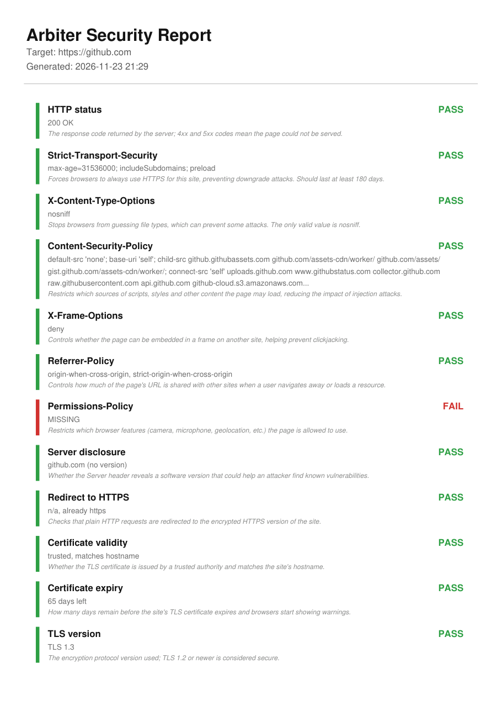

# Arbiter

[](https://github.com/hasia17/arbiter/actions/workflows/test.yml)

A command-line tool written in Go that scans a website and reports on its basic
security hygiene: HTTP security headers, TLS, cookies, DNS and more. Results are
printed to the terminal and can optionally be exported as a PDF report.

## Features

| Check | Passes when |
|---|---|
| HTTP status | the server responds with a non-error status (< 400) |
| Strict-Transport-Security | served over HTTPS with `max-age` of at least 180 days |
| X-Content-Type-Options | header is `nosniff` |
| Content-Security-Policy | header is present |
| X-Frame-Options | header is `DENY` or `SAMEORIGIN` |
| Referrer-Policy | header is present and not `unsafe-url` |
| Permissions-Policy | header is present |
| Server disclosure | the `Server` header doesn't expose a version (e.g. `nginx/1.18.0`) |
| Redirect to HTTPS | `http://` requests end up on `https://` |
| Certificate validity | the certificate chains to a trusted root and matches the hostname |
| Certificate expiry | the certificate is valid for at least 14 more days |
| TLS version | TLS 1.2 or newer is negotiated |
| Cookies | every cookie (including ones set during redirects) is `Secure` and `HttpOnly` |
| security.txt | `/.well-known/security.txt` exists and is served as `text/plain` |
| DNS records | the hostname resolves |
| SPF record | a `v=spf1` TXT record exists |

### How broken sites are scanned

A normal HTTP client refuses to connect to a site with an expired or
self-signed certificate, or one that only speaks TLS 1.0, so the scan would
stop with an error exactly when it matters most. Arbiter's client therefore
accepts any certificate and TLS 1.0+, and then verifies the certificate itself
as a separate check. That way such sites get a full report with clear FAIL
results instead of a connection error.

## Requirements

- Go 1.25+

## Usage

```sh
go run . -url https://example.com
```

Write a PDF report as well (saved to the `reports/` directory):

```sh
go run . -url https://example.com -out example.pdf
```

Or build a binary first:

```sh
go build -o arbiter .
./arbiter -url https://example.com -out example.pdf
```

### Flags

| Flag | Required | Description |
|---|---|---|
| `-url` | yes | URL to scan; must start with `http://` or `https://` |
| `-out` | no | file name (not a path) for the PDF report, written to `reports/` |

### Exit codes

| Code | Meaning |
|---|---|
| `0` | all checks passed |
| `1` | the scan finished, but at least one check failed |
| `2` | bad usage, or the site could not be scanned at all |

This makes Arbiter usable in CI pipelines and scripts. Results are printed to
stdout and errors to stderr.

### Example output

```
[PASS] HTTP status: 200 OK
[PASS] Strict-Transport-Security: max-age=31536000; includeSubdomains; preload
[PASS] X-Content-Type-Options: nosniff
[FAIL] Permissions-Policy: MISSING
[FAIL] Server disclosure: version exposed: nginx/1.10.3 (Ubuntu)
[FAIL] Certificate validity: x509: certificate signed by unknown authority
...

13 of 16 checks passed
```

And the first page of the PDF report for `https://github.com`:



> **Note:** the PDF uses the built-in Arial font, which only covers the
> Western European (cp1252) character set. Other characters, such as Polish
> `ś` or `ż`, appear as `.` in the PDF; the terminal output is unaffected.

## Project structure

```
.
├── main.go                 # CLI: flag parsing, URL validation, output
└── internal/
    ├── checks/             # the individual security checks
    └── report/             # PDF report generation (go-pdf/fpdf)
```

## Running tests

```sh
go test ./...
```

## Disclaimer

Arbiter performs only passive, read-only requests (the same ones a browser
would make). It is a quick hygiene check, not a full security audit. Only scan
sites you own or have permission to test.
